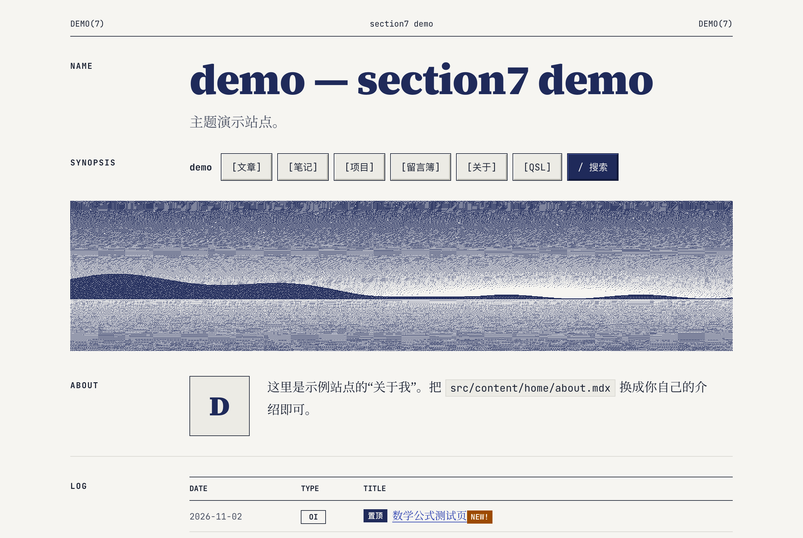
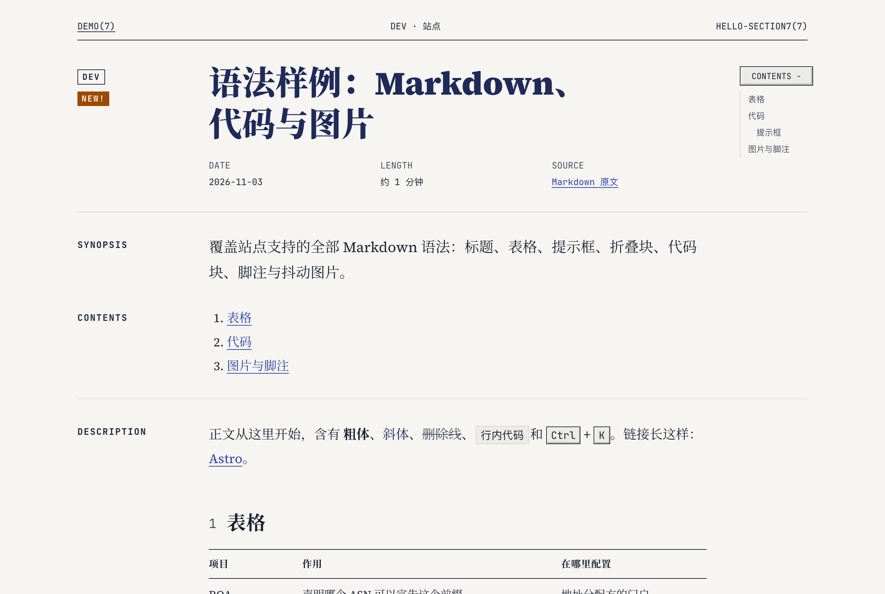
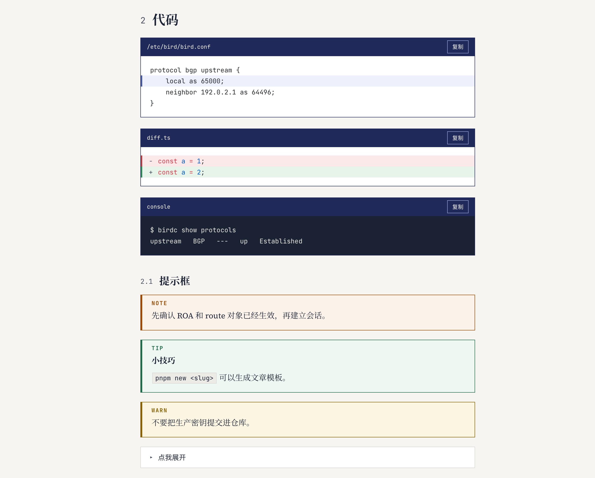
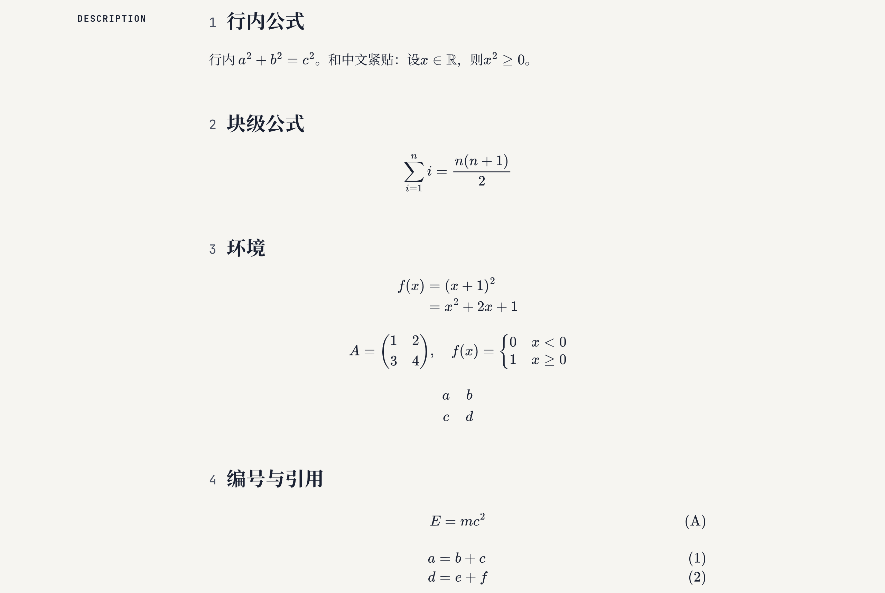
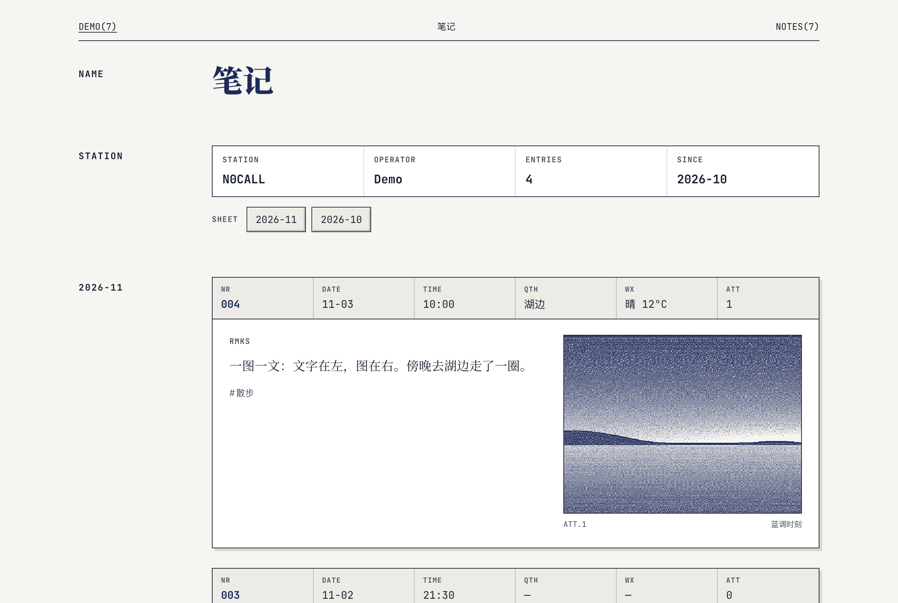
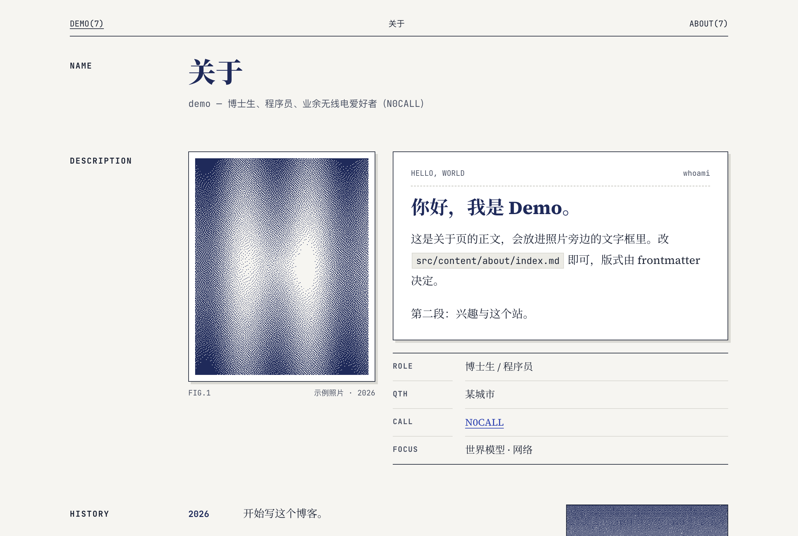
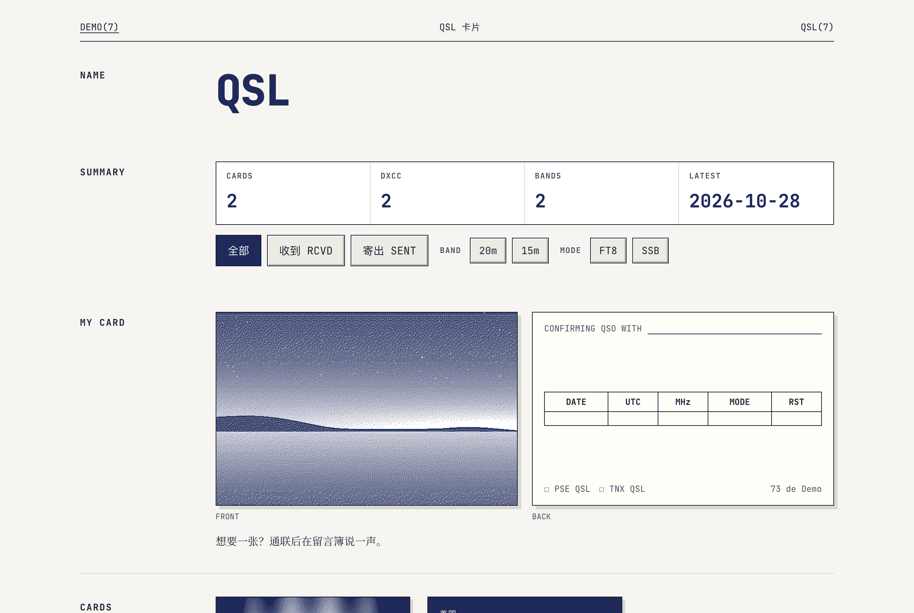

<div align="center">

# section7

**一个 man page 风格的 Astro 博客主题**

Unix 手册页的骨架 · 日志簿的排版 · 蓝调时刻的配色

[](https://astro.build)
[](https://nodejs.org)
[](https://pnpm.io)
[](https://github.com/yueyangw/section7/actions/workflows/ci.yml)
[](LICENSE)

[快速开始](#快速开始) · [功能](#功能) · [预览](#预览) · [写作](#写作) · [配置](#配置) · [开发](#开发主题)

<br>



</div>

<br>

> 名字取自 `man` 手册第 7 节：Miscellaneous，杂项。博客本来就是杂项。

section7 把每一页都排成一份手册：左栏是 `NAME`、`SYNOPSIS`、`DESCRIPTION` 这样的段落标签，右栏是正文；页眉写着 `PAGE(7)`，页脚写着 `73`。图片抖动成双色点阵，代码块戴着靛蓝色标题栏，笔记按通联日志的格式记账。

主题和内容完全分离。你的博客仓库里只有 Markdown、YAML 和图片，升级主题只需一行命令。

## 功能

<table>
<tr>
<td width="50%" valign="top">

### 排版

- 手册页式双栏骨架，西文 Source Serif 4，中文思源宋体，等宽 JetBrains Mono
- 全站只通过 CSS 设计 token 取色，`site.customCss` 一处覆盖
- 字体全部自托管，没有外部 CDN 请求
- 纯静态输出，交互部分用 React islands 按需加载

</td>
<td width="50%" valign="top">

### 数学

- 构建期 MathJax 直出 SVG，页面不加载任何数学 JS
- 支持 `align`、`\tag`、`\eqref`、`\newcommand`、mhchem 化学式
- 公式写错时构建直接失败，报出文件、行号和 TeX 源码

</td>
</tr>
<tr>
<td valign="top">

### 图片

- 默认抖动成双色点阵（Atkinson / Floyd–Steinberg / Bayer）
- 本地图片在构建期处理；图床图片在浏览器端用同一算法实时抖动
- 点击灯箱看原图，可整篇或单张关闭抖动

</td>
<td valign="top">

### 代码与内容块

- Shiki 高亮，带文件名标题栏、复制按钮、diff、行高亮、终端深色底
- 提示框 `note` / `tip` / `warning` / `danger`，折叠块
- 三线表、脚注、文内目录、阅读进度

</td>
</tr>
<tr>
<td valign="top">

### 页面

- 首页、归档、类型、标签、系列文章、置顶
- 笔记（通联日志式）、项目、关于（含友链）
- QSL 卡片墙、留言簿、自定义页面、404

</td>
<td valign="top">

### 发布

- Pagefind 中文全文搜索
- RSS、sitemap、JSON-LD
- `llms.txt`，每篇文章都有 `.md` 原文地址
- 可选 Artalk 评论与阅读量

</td>
</tr>
</table>

## 预览

<table>
<tr>
<td width="50%"><p align="center"><sub><b>文章</b>：手册页式文章头、元信息与浮动目录</sub></p></td>
<td width="50%"><p align="center"><sub><b>代码与提示框</b>：标题栏、diff、终端、四种提示框</sub></p></td>
</tr>
<tr>
<td><p align="center"><sub><b>数学</b>：构建期渲染的 SVG 公式、编号与引用</sub></p></td>
<td><p align="center"><sub><b>笔记</b>：通联日志式短记，0 / 1 / 2 / 3+ 张图各有版式</sub></p></td>
</tr>
<tr>
<td><p align="center"><sub><b>关于</b>：照片、自我介绍、履历与友链</sub></p></td>
<td><p align="center"><sub><b>QSL</b>：卡片墙，没写背面时按通联记录自动生成</sub></p></td>
</tr>
</table>

## 快速开始

> [!NOTE]
> 本仓库只包含主题。你的文章、站点配置和部署脚本放在另一个（可以是私有的）博客仓库里，通过依赖引入本主题。

**1. 安装**

```bash
pnpm add astro @astrojs/react @astrojs/mdx react react-dom section7-theme@github:yueyangw/section7
```

**2. `astro.config.ts`**（写一次，之后不用再改）

```ts
import { defineConfig } from 'astro/config';
import section7 from 'section7-theme';

const s7 = section7('site.yaml');

export default defineConfig({
  site: s7.site.url,
  output: 'static',
  trailingSlash: 'always',
  integrations: s7.integrations,
  markdown: s7.markdown,
  vite: s7.vite,
});
```

**3. `src/content.config.ts`**

```ts
export { collections } from 'section7-theme/content';
```

**4. `site.yaml`**

```yaml
url: https://example.com
title: 我的博客
manName: EXAMPLE.COM
author: { name: York, github: yourname, callsign: N0CALL, avatar: ./assets/me.jpg }
home:
  banner: { src: ./assets/banner.jpg, caption: 傍晚的湖 } # true 用主题内置图，false 不显示
```

然后执行 `pnpm astro dev`，站点就跑起来了。完整的示例站点见 [`demo/`](demo/)。

**升级主题**

```bash
pnpm up section7-theme
```

## 配置

`site.yaml` 只需要写你想覆盖的字段，其余字段取主题默认值，全部默认值见 [`src/node/defaults.js`](src/node/defaults.js)。也可以直接给 `section7({...})` 传一个对象。

| 想做的事        | 方法                                                   |
| --------------- | ------------------------------------------------------ |
| 改配色、字号等  | `site.customCss` 指向一份样式表，覆盖 CSS 变量         |
| 改写某个页面    | 在博客仓库的 `src/pages/` 下建同名路由，优先于主题路由 |
| 加一个导航页    | 在 `content/pages/` 写 Markdown，frontmatter 设 `nav`  |
| 开评论 / 阅读量 | 在 `site.yaml` 里填 `artalk.server` 和 `artalk.site`   |

## 写作

所有内容都放在博客仓库的 `src/` 下，schema 定义见 [`content.ts`](content.ts)。

| 路径                           | 页面           | 说明                                                                                                                        |
| ------------------------------ | -------------- | --------------------------------------------------------------------------------------------------------------------------- |
| `content/posts/**/index.md`    | 文章           | 可按年/月/日嵌套目录。`pinned: true` 置顶，首页排在最前，其余列表显示标记；多篇置顶时写数字，数字小的在前                   |
| `content/notes/*.md`           | `/notes/` 笔记 | 通联日志式排版。frontmatter 支持 `qth` `wx` `images`                                                                        |
| `content/about/index.md`       | `/about/` 关于 | `photo` `photoSide` `greeting` `facts` `history` `now` 控制版式，正文放进照片旁的文字框，友链接在下面                       |
| `data/friends.yaml`            | 关于页 FRIENDS | `avatar` 可以省略，构建期会自动抓取对方站点的图标                                                                           |
| `content/qsl/<名>/card.yaml`   | `/qsl/` QSL    | `call` `dir`(rcvd/sent/mine) `date` `utc` `freq` `mode` `rst` `dxcc` `via` `front` `back`；不写 `back` 时按通联记录生成背面 |
| `content/projects/*/index.mdx` | 项目           |                                                                                                                             |
| `content/pages/*.md`           | 自定义页面     | 设置 `nav` 后进入首页导航                                                                                                   |

frontmatter 里的图片可以写相对当前文件的路径（构建期抖动），也可以写图床 URL（浏览器端抖动）。

<details>
<summary><b>Markdown 扩展语法</b></summary>

<br>

**代码块**

````md
```ts title="diff.ts"
const a = 1; // [!code --]
const a = 2; // [!code ++]
const b = 3; // [!code highlight]
```
````

**提示框与折叠块**

```md
:::tip[小技巧]
`pnpm new <slug>` 可以生成文章模板。
:::

:::details[点我展开]
折叠的内容。
:::
```

提示框有 `:::note` `:::tip` `:::warning` `:::danger` 四种，标题 `[...]` 可省略。

**关闭图片抖动**：整篇在 frontmatter 写 `dither: false`；单张在图片 title 里加 `#nodither`。

**手写 ``**：Typora 等工具导出的 `` 标签只要单独成段，处理方式和 `` 一样。

</details>

<details>
<summary><b>构建细节</b></summary>

<br>

- **抖动缓存**：抖动结果缓存在博客仓库的 `.cache/` 里。
- **图床图片**：浏览器端读取像素需要图床允许跨域（CORS）。不允许时退回 SVG 双色滤镜，图片不会显示失败。
- **友链图标**：缓存在 `.cache/favicons.json`，成功的 30 天后刷新，失败的 1 天后重试。设置 `SECTION7_OFFLINE=1` 时只用缓存，不联网。
- **缓存失效**：主题的构建代码、图片或公式配置变化时，会自动清掉 Astro 的内容缓存并重新渲染（指纹记在 `.cache/section7-build.txt`）。
- **公式迁移**：迁移旧文章的过渡期，可以用 `MATH_STRICT=0` 把公式错误降级为警告。
- **旧链接**：`/friends/` 会跳转到 `/about/#friends`；没有 `content/about/` 时沿用 `pages/about.md` 作为关于页正文。

</details>

## 开发主题

需要 Node 22+ 和 pnpm 12。

```bash
pnpm install
pnpm dev      # 运行 demo 站点
pnpm build    # 构建 demo 并生成搜索索引
pnpm test
pnpm lint
```

## License

[MIT](LICENSE) © 2026 York Wu

<div align="center">
<br>
<sub><code>SECTION7(7)</code> &nbsp;·&nbsp; 73</sub>
</div>
